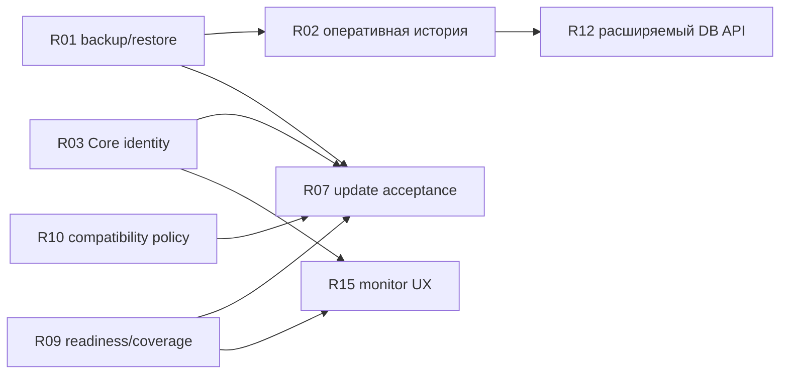

# Общая очередь новых задач и рефакторинга

2026-10-22. Рекомендация по фактическим карточкам, successor reports, Git и точечному чтению текущего кода. База Git — 34b57d75e53c8597a104c1643be40193156a15da; отдельно учтён незавершённый dirty-кандидат OOP54–55. Контекст ctx-20261021-162229-c46ea2 — fresh/continue. Это planning-only результат: существующие приоритеты, DAG, scopes, capsules и статусы не редактировались. Реализация и paused refactor не запускались.

## Вывод

Пересечение существенное: новые задачи работают с теми же владельцами Core, которые входят в OOP-01–OOP-05. Рефакторинг имеет смысл выполнять ограниченными срезами внутри соответствующих результатов. Одна область нового поведения и её поведенческий refactor сохраняют отдельные критерии приёмки. Общая программа Core не является обязательной предварительной переписью всего продукта.

В текущем bootstrap по-прежнему вызывается _load_legacy_core; в composition остаются core: Any и callbacks. Поэтому пять OOP-эпиков не закрыты, хотя многие owners и consumers уже перенесены. Счётчик принятых блоков и число новых классов не дают процента завершения.

## Ранжирование

P1 — наблюдаемые эксплуатационные проблемы, безопасность данных и ближайший незавершённый кандидат. P2 — устойчивость общего Core, проверяемая поставка и сопровождение. P3 — платформенное расширение и дополнительный UX. P4 — отложенные пользователем вопросы и возможности без доказанной текущей необходимости. Это предложенный порядок, а не изменение native priority.

Сортировка: приоритет по убыванию важности P1 → P4, внутри него техническая сложность по убыванию 5 → 1. Одинаковые оценки упорядочены по риску и зависимостям. 1 — локально; 2 — небольшой adapter/research; 3 — связный срез с несколькими consumers; 4 — сквозной контракт/миграция; 5 — многосрезовая архитектурная программа. Это сложность интеграции и проверки, не оценка часов, числа запросов или токенов. Пункты 5/5 до исполнения нужно дробить.

| № | Приоритет | Сложность | Результат | Пересечение |
| --- | --- | --- | --- | --- |
| 1 | P1 | 4/5 | Резервирование, целостность и восстановление SQLite/журналов | OOP-02 |
| 2 | P1 | 4/5 | Оперативные исполнения отдельно от накопленной истории | OOP-02, OOP-03, OOP-05 |
| 3 | P1 | 4/5 | Единые свойства Core и installed/loaded provenance | OOP-01, OOP-05 |
| 4 | P1 | 4/5 | Разделить project-context refresh и workplace индексацию | OOP-01, OOP-02, OOP-05 |
| 5 | P1 | 3/5 | Довести сохранённый кандидат OOP54–55 до независимой приёмки | OOP-02, OOP-04 |
| 6 | P2 | 5/5 | Остаток Core: независимая композиция, state repositories, lifecycle и тонкие адаптеры | OOP-01, OOP-02, OOP-03, OOP-05 |
| 7 | P2 | 5/5 | Единый управляемый сценарий обновления и окончательная проверка | OOP-03, OOP-05 |
| 8 | P2 | 4/5 | Целевое unit coverage и регрессии критических контрактов | OOP-01, OOP-02, OOP-03, OOP-04, OOP-05 |
| 9 | P2 | 4/5 | Раздельная диагностика Runtime, контекста и полноты статистики | OOP-01, OOP-03, OOP-05 |
| 10 | P2 | 3/5 | Матрица совместимости обновлений и проверяемые команды руководства | OOP-05 |
| 11 | P2 | 3/5 | Документация и ownership/API-карта Core | OOP-01, OOP-02, OOP-03, OOP-04, OOP-05 |
| 12 | P3 | 5/5 | Общий расширяемый DB API и дополнительные backend drivers | OOP-02, OOP-04 |
| 13 | P3 | 4/5 | Остаток контрактов расширений и conformance | OOP-04 |
| 14 | P3 | 4/5 | Дополнительные agent hooks и квалификация native capture | OOP-04, OOP-05 |
| 15 | P3 | 3/5 | Дальнейшее развитие монитора: Textual, проекты и детали | OOP-05 |
| 16 | P3 | 2/5 | Готовый Windows-запуск существующего монитора и TERM=dumb | OOP-05 |
| 17 | P4 | 4/5 | Обязательные ресурсы специализаций и явный выбор/допуск Work | OOP-02, OOP-04, OOP-05 |
| 18 | P4 | 2/5 | Исследовать необходимость общего HTTP-клиента/MCP-инструмента | OOP-04, OOP-05 |

Полные ID, границы каждой строки, зависимости и sources находятся в [roadmap.json](roadmap.json). Один Task может входить в несколько строк как разные фазы; его работа не считается выполненной дважды. R01/R02/R12 особенно важно не сворачивать в одну широкую реализацию.

## Где задачи затрагивают друг друга

| Общая область | Новые требования | Остаток рефакторинга | Как избежать повторной работы |
| --- | --- | --- | --- |
| Composition/identity | Core properties, provenance, диагностика, полный update | OOP-01/05; bootstrap, composition, CLI/MCP/monitor/service | Один владелец Core identity, все его реальные consumers; не отдельный VERSION parser на сервис |
| Состояние и журналы | Backup, оперативные executions, общий DB API | OOP-02/03; SQLite helpers, event/raw journals, worker histories | Общие infra primitives, отдельные domain repositories; текущие executions отделить от аудита |
| Контекст, поиск, ресурсы | Refresh/index ownership, обязательные ресурсы специализаций | OOP-01/02/04/05; snapshot/registry/path readers | Сохранить live reads и текущие grants; перенос owner индекса не расширяет доступ |
| Lifecycle/транспорт | Integrated update, error/partial states, evidence consumers | OOP-03/05; use cases и thin adapters | Повторно использовать общие DTO/политики; проверять CLI/MCP parity на одном corpus |
| Провайдеры | Дополнительные hooks, native capture Kimi | OOP-04/05; driver/provider contracts | Один agent/version на срез, existing AccountingService для usage; hooks не равны accounting capture |
| Проверки и документация | Unit coverage, ownership/API docs | Все пять эпиков | Прилагать к принятому срезу; общий остаток вести без повторного полного аудита |

Один и тот же tools/processforge.py нужен R03/R04/R05/R06 и части adapter задач. Разные методы в этом файле не образуют независимые writer scopes. Изменения storage/accounting/journals также нельзя вести параллельно без явного владельца схемы и миграции.

## Подтверждённые факты и границы

- Кандидат 54–55 не принят и не опубликован: checkpoint сообщает fixed F1 и pending independent delta review. Старый primary cancelled; c формально in_progress. Текущие raw hashes совпали для 6 из 8 candidate-v2 файлов. Изменились Main и checksum inventory. Поэтому нужен актуальный delta review и новый допустимый scope, а не повтор всей реализации или возврат старого Main.
- После 18 октября уже приняты серии 18–37, 38–45 и 46–53. Старый architecture implementation-plan с предложениями первого merge/classifier среза не является текущим списком ещё не выполненных блоков.
- Дефект Core identity подтверждён: PROCESSFORGE_VERSION = "1.2.0" остаётся в Main при release/installed alpha2. Само получение значения через core facade не означает канонический owner. R03 должен различать disk-installed и process-loaded build, Runtime/protocol/spec versions.
- command_project_context_refresh всё ещё вызывает search_index_maintenance_for_known_projects. Это подтверждает текущую связь. Полная стоимость/все условия индексатора в этой задаче не измерялись; R04 начинает с узкого замера, затем меняет owner запуска.
- Сбой stop/busy guard на растущей истории сохранён в DB specification. Alternative source fix был cancelled: выполнен разовый операторский force, продуктовый guard не исправлялся. R02 не означает увеличение числа просматриваемых файлов. Текущая остановка Runtime здесь не повторялась.
- Общий accounting store уже реализован и имеет собственный scoped service/repository, read-only snapshot и consistent backup. В src/processforge_core/sqlite_storage.py уже есть database/transaction/metadata primitives. R01/R02/R12 должны инвентаризировать и переиспользовать эти контракты. Full multi-backend DAL не нужен для первой SQLite-фазы; существующий accounting.sqlite3 не переносится без отдельной миграции и приёмки.
- Не нужно начинать универсальный framework расширений до каждого нового adapter. Существующие declarative contracts используются сейчас; R13 закрывает их конкретный остаток/conformance, R14 — конкретных провайдеров. Автонастройка Kimi в Forge и native Kimi usage capture не объявляются уже завершёнными.

## Зависимости и ближайший ограниченный цикл

Список приоритетов не равен порядку выполнения всех подпунктов. Например, политика совместимости R10 задаёт вход R07, а финальный E2E матрицы использует уже готовый R07. Процедуры R01 нужны до миграции данных R02. R03 и представление состояний R09 нужны для достоверного итога обновления и дальнейшего интерфейса.

С учётом лимитов ближайший управляемый цикл: актуализировать и независимо принять сохранённый 54–55 candidate; затем выполнить один целостный R03 срез identity с нужными tests/docs. Это ограничивает дрейф уже готового кода и устраняет непосредственно наблюдаемое расхождение. R01/R02 готовить следующим циклом; если отказ остановки реально блокирует работу сейчас, R01/R02 получают первое исполнение перед архитектурным продолжением. Здесь это исторический подтверждённый дефект, текущий blocker не воспроизводился.

R04 даёт отдельную пользу по времени и повторным обходам документации, но не должен автоматически запускать device-wide jobs из project Work. Оставшийся OOP вести по нужным use cases, с завершением каждого принятого среза; это не разрешение продолжать все эпики автоматически.

Экономия агентного бюджета: один writer на связный срез, один независимый review после готовой реализации, точные старые inputs вместо нового полного аудита, один integration/release набор на интегрированный результат. Применимые обязательные Python QA и значимые проверки не отменяются. Unit tests и docs добавлять вместе с владельцем; отдельную глобальную перепись docstrings и механические тесты переносов не планировать в ближайший цикл. Количественные лимиты пользователя не указаны; автоматических квот или сроков этот документ не назначает.

## Что вычтено из повторной реализации

Уже выполнены successor Works для token/time accounting, Forge/Codex init, CLI/MCP context parity и uptime; также доставлены evidence guidance и advisory artifact authoring. Эти возможности сохраняются, но заново в очередь реализации не включены.

Исходный server-window slice также принят и установлен: старое open в базовой UX карточке не означает, что его нужно делать снова. Textual monitor/autostart/project drilldown сохранены как будущие требования/идеи; R15 не означает уже согласованный новый scope. Windows launcher R16 может обслуживать текущий монитор независимо от Textual.

Материалы аудита 14 октября содержат 10 proposed_not_registered пунктов и одну reused existing Unicode карточку. Их нельзя выдавать за 10 новых открытых native tasks. В нынешнем коде уже есть явная UTF-8 stdio настройка MCP, maxItems/minItems проверки и ограничения длины/finite JSON Runtime HTTP body. Текущая полная приёмка старых findings не повторялась; status существующей Unicode карточки остаётся open. Эти acceptance хвосты включены в R08, task-batch/egress/critical-function qualification также в R08, startup compatibility в R10/R06, lease documentation в R11, context ownership в R04/R06. Новые дубли не создаются.

## Проверка и ограничения

Проверены native context/state/capsule, выбранные task metadata и successor reports, исходный план пяти эпиков, точечные символы и вызовы актуального кода, candidate hashes и scoped Git status. Исторические планы не заменяют текущую source проверку. Полное поведенческое покрытие, performance benchmark, проверка новых DB drivers, installer/Runtime/MCP restart и реализация отсутствуют. Source и installed evidence не смешиваются: этот приоритетный анализ относится к current source/tasks и предыдущим явно помеченным receipts.

Planning-only вывод сохранён отдельно. Существующие cards/priorities/capsules и незавершённые продуктовые файлы остаются без изменений. Точная native identity этой проверки находится в plan.md, а события решения — в журнале.

