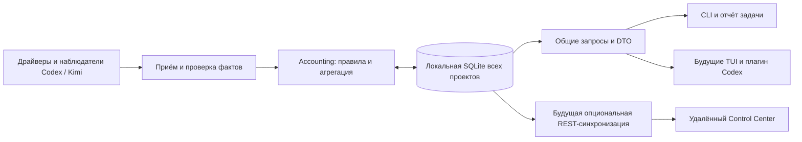

# План: общий учёт времени агентов, токенов и затрат

Статус: спроектировано 2026-10-22; **реализация продукта не начата**. Исходная задача `pf-task-token-usage-logs-20261020` остаётся open/planning_only. Этот документ — вход будущего исполнительского Work, а не разрешение на код, выпуск или изменение инфраструктуры.

## Предлагаемое решение

Один небольшой модуль `accounting` внутри PF и одно долговечное локальное SQLite-хранилище на workplace. Драйверы/адаптеры поставляют подтверждённые измерения. Общие прикладные операции принимают их и строят одинаковые отчёты для CLI, будущего Control Center/TUI и плагина Codex. Позднее отдельный адаптер синхронизирует те же факты с удалённым Control Center. Для локального учёта не нужен запущенный Runtime или сервер.

Здесь нет нового брокера событий, фонового сервиса, универсальной ORM, отдельного backend на каждый UI или переноса PF lifecycle в БД. Хранилище отвечает только за учёт; определения/состояния Work и полномочия остаются в существующих контрактах PF.

## Что измеряем

| Показатель | Смысл |
| --- | --- |
| Время выполнения агентов | Сумма наблюдаемых интервалов по экземплярам агентов без вложенного двойного счёта. Время инструментов/сети внутри worker входит в elapsed; это не CPU и не только время генерации. |
| Занятость проекта | Объединение интервалов всех агентов. Два агента одновременно по 10 минут: 20 агент-минут, 10 минут занятости. |
| Токены | Фактические usage receipts; общий input/output и подтверждённые подкатегории cache/reasoning. Объём контекста и оценки по тексту не расход. |
| Деньги | Отдельно сумма, сообщённая провайдером, и оценка по закреплённому тарифу. Расчёт по API-цене не объявляется реальным списанием по подписке. |
| Полнота | Какие исполнения учтены, где usage/тариф/привязка неизвестны, насколько свеж сбор. Отсутствующие данные не заменяются нулями. |

Учитываются основные интерактивные агенты, managed workers, subagents, повторные/неудачные/прерванные попытки и compaction — в пределах подтверждённых источников. Открытая сессия и heartbeat сами по себе не измеряют работу; время между turns не накапливается. Первая версия показывает elapsed с обозначением типа измерения; точное отделение approval/human wait возможно лишь при наличии соответствующих событий, CPU/billable inference time не обещаются.

## Источники: уже проверено и что предстоит

Существующий `codex-exec` не собирает структурированный usage. Его нужно расширить сбором поддерживаемого потока/receipt, сохранив контракты ответа, heartbeat и exit. Нужна отдельная проверка источника для интерактивного Codex: будущий плагин сможет читать статистику, но его наличие не доказывает доступ к счётчикам самого клиента. Не строить основную модель на недоказанной plugin API.

Для установленного **Kimi Code 2.3.0** найдены `usage.record`, модель и входные/выходные/кэш-категории; структура и накопление подтверждены в программном bundle. Прежний Python Kimi CLI использует другой источник `StatusUpdate.token_usage`. Это разные профили адаптера. В новом формате scope `session` не равен автоматически cumulative snapshot; общим фильтром его отбрасывать нельзя. Подробности и первичные ссылки: [Kimi addendum](kimi-source-addendum.md). `PreCompact.token_count` относится к размеру контекста.

До реализации сбора для каждого клиента закрепить client/protocol version, реальные обезличенные receipts и matrix: identity, delta/snapshot, модель, input/cache/output/reasoning, compaction, retries, subagents, interruption, время, binding. Источник без нужного сигнала даёт explicit unsupported/partial. Читать только конкретные разрешённые PF session/attempt logs; глобальный обход приватных историй агентов в первую версию не входит. Установка хуков/плагинов/сервисов не является частью автоматического сбора по умолчанию.

## Границы кода и данных

Начальный ориентир — **один пакет, около пяти модулей**, без обязательного дробления на множество классов:

- `model.py` и `rules.py`: небольшие типы UsageRecord/ActivityInterval/RateCard/Valuation, идентичность, семантика счётчиков, проверка, интервалы и формулы. Чистые функции, без файлов, CLI, HTTP или knowledge о Kimi/Codex.
- `service.py`: приём нормализованного batch, пересборка/сверка источника и запросы project/task summaries. Общая проверка допустимой привязки, качества и идемпотентности.
- `storage.py`: SQLite repository, миграции, source cursors, транзакции, индексы. Использовать подходящие существующие `sqlite_storage` primitives, но не таблицы lifecycle-журнала: его отключаемая история не гарантирует бухгалтерскую сохранность.
- `valuation.py`: применение конкретной версии тарифа к непересекающимся категориям; Decimal, отдельная валюта и provenance результата.

Provider-specific mapping остаётся около существующих драйверов/host adapters. CLI/MCP, Monitor/TUI, plugin и будущий REST — тонкие входы/выходы прикладного слоя. Существующий механизм session/Work binding переиспользуется; второй конкурирующий реестр session-to-task не создаётся.

Предлагаемое место БД: `<workplace>/data/accounting/accounting.sqlite3`, через существующий workplace path/config resolver; окончательно проверить договор владения каталогом в первом исполнительском блоке. Это долговечные пользовательские данные вне Git, установочного каталога Core и очищаемых Runtime caches. Резервирование — SQLite backup через существующий подход, не копирование открытой БД вслепую. Перемещение project checkout не теряет историю.

Минимум логических таблиц: usage facts/revisions, activity facts/revisions, rate versions, valuations; служебные project mappings и source cursors/capabilities. Индексы по project/Work/time/source unit. Не держать параллельно JSONL и SQLite как две истины; task reports — производные снимки с `as_of`/версией, live-запрос — актуальная сводка. В первой версии агрегация SQL + простые функции; дополнительные materialized totals только после измерения необходимости.

Ключевые поля каждой записи: schema version, origin id, устойчивый source/unit key, source revision/supersedes, project UUID, существующие PF project/run/assignment/attempt при доказанной привязке, agent instance/session, provider/model, observed/occurred UTC timestamps, измерения/качество и приватный source reference/hash. Локальный cursor — не публичный идентификатор факта. При отсутствии upstream ID адаптер доказывает устойчивость journal occurrence/generation при replay/export; иначе запись не считается надёжно атрибутированной.

## Правила суммирования и оценки

1. Один расход даёт один вклад. Повторный collect, reconnect, mirror subagent или доставка другим транспортом не создают новую стоимость. Приоритет источника/coverage задаётся явно: request receipts и summary тех же вызовов одновременно не складываются. Разные реальные одинаковые запросы сохраняют разные occurrence IDs.
2. Snapshot одного unit обновляет его вклад по source revision; delta имеет отдельный occurrence. Late events не переписывают новый snapshot по времени прибытия. Cumulative session counters требуют baseline/epoch/порядка; неизвестную историю не приписывать текущей задаче.
3. `input_total + output_total` — общий расход, когда семантика известна. Cache уже входит во вход, reasoning уже входит в выход при соответствующем контракте. Kimi disjoint `inputOther + inputCacheRead + inputCacheCreation` сначала преобразуется в input_total. Неизвестные поля остаются null, а не SDK default0.
4. Проектный итог включает подтверждённые задачи плюс проектный расход без задачи. Неизвестная project identity не распределяется по догадке. Сумма всей сессии не копируется в каждую задачу. Project UUID не выводится из совпавшего имени; межустройственное объединение через явное mapping.
5. Тариф задаётся локально версионированной записью: provider/model/billing mode/tier, currency, effective time, ставки за единицу и источник. Существующие факты не меняются при изменении тарифа. Расчёт сохраняет rate/usage revision и algorithm version. Без подходящего тарифа или с неподдерживаемой категорией стоимость unknown/partial. Автозагрузка прайсов и FX отсутствуют.
6. В сводке выводить `reported_cost` и `estimated_cost` раздельно, по валютам, с покрытием каждого. Не прибавлять обе оценки для одного unit и не складывать валюты. Допустимый общий display total выбирает одну valuation для каждого непересекающегося покрытия и явно сообщает basis.
7. Нормализованный приём и cursor фиксируются одной транзакцией; conflict/hash mismatch диагностируется. Сбой учёта не меняет worker exit/Work outcome: сохраняется возможность replay, отчёт показывает backlog/error. Если источник нельзя безопасно сохранить/повторить, показывается gap — обещания абсолютной полноты нет.

Полные определения, включая UTC/monotonic, незавершённые интервалы и временные фильтры: [domain.md](domain.md).

## Общий интерфейс чтения

Один application query contract версии1: список/сводки проектов; сводка и детализация project/run/assignment/attempt; фильтры по периоду, модели, provider и agent instance; разбор missing/unassigned. Пагинация деталей, ограниченный размер ответа, `as_of`, freshness и coverage в каждом результате. Точные имена CLI/MCP команд закрепить при реализации; сейчас это не выпущенный API.

Все клиенты получают один DTO: observed token totals и breakdown; execution/occupied duration с measurement kind; money by currency/basis; missing/partial/unsupported counts; attribution coverage. Фильтры по времени явно определяют: интервалы обрезаются по границам, usage относится к timestamp receipt. Межустройственный occupied time содержит оговорку о качестве часов. Авторизация чтения определяет допустимый project scope; task-read не даёт workplace-wide доступ.

Первый пользовательский результат — CLI/JSON сводка всех доступных проектов и статистика задачи со ссылками на доступные логи попыток. Если store/source недоступен, отчёт говорит unavailable; создание задачи и file-only PF продолжают работать. Встроенный отчёт при завершении — snapshot, дальнейшее уточнение receipt видно через live-запрос и явную пересборку.

## Будущие интерфейсы и синхронизация

**Control Center/TUI.** Расширять Monitor как оболочку можно, но экран статистики читает accounting service, а не числа из Runtime health cache. Выбор TUI-библиотеки и переписывание Monitor сейчас не нужны.

**Codex plugin.** Показывает те же project/task queries через поддерживаемый локальный PF facade (MCP либо другой подтверждённый plugin bridge). Не читает SQLite напрямую и не хранит свой учёт. Query-контракт переносим, конкретный SDK и host access проверяются в отдельной задаче. Если plugin когда-нибудь поставляет usage, это отдельный проверяемый collector profile, не основание доверять произвольной статистике.

**REST sync.** Отдельная опциональная задача; выключена по умолчанию. Уже сейчас нужны stable origin/fact IDs, schema version, revision и локальная sequence. Позднее exporter отправляет bounded batch нормализованных фактов/уточнений и необходимых valuation/rate snapshots; удалённая сторона принимает идемпотентно, возвращает cursor/ack. Протокол предусматривает at-least-once, retry/backoff и явный conflict; один факт не учитывается снова при relay или восстановлении устройства. Не синхронизировать суммарные project snapshots как независимые расходы. Локальная БД остаётся работоспособной offline; удалённый CC строит агрегаты из тех же уникальных фактов.

Для включения sync понадобятся выбранный endpoint, аутентификация, project allowlist/mapping и политика удаления/retention. Отправляются счётчики, безопасные идентификаторы/метки, интервалы и valuation metadata; сырые промпты, ответы, private paths, credentials и logs не уходят. Политику retraction/deletion и новой origin после клонирования устройства реализовать до внешней доставки, сейчас не создавать универсальный sync engine.

## Порядок реализации после отдельного разрешения

| Блок | Конкретный результат и проверяемый выход |
| --- | --- |
| 1. Источники и контракт | Client/protocol capability matrix и scrubbed реальные fixtures для установленного Kimi Code и managed/interactive Codex. Доказаны identity, delta/snapshot, model provenance, compaction/retry/subagent coverage. Неподдерживаемый канал явно помечен. Профиль старого Kimi только при реальной необходимости. |
| 2. Локальный сквозной учёт | Нейтральные типы/правила, SQLite/replay/cursors, выбранные collectors и интервалы; минимальный CLI/JSON на одном реальном project/attempt, затем cross-project/task summaries. Работает file-only, без сервиса. Успешные/failed/interrupted попытки и project-unassigned видны. |
| 3. Деньги и итог задачи | Локальные versioned rates, Decimal valuation с неизвестными/partial категориями, валюты и basis, coverage и ссылки на логи. Проверка task sums versus project total. Минимальный отчёт завершения задачи и live queries. |
| 4. Приёмка и поставка локальной функции | Fixtures/реальный источник, replay/restart/rotation/conflict и concurrent collectors; проверки качества затронутого Python; документация и отдельный governed delivery. Install/restart — только в разрешённом scope будущей задачи. |
| Позже, отдельно | UI Control Center/TUI; plugin; REST sync. Они используют тот же accounting контракт, не меняя доменную арифметику и не требуя переделки хранения ради каждого клиента. |

Блоки1–3 — первая локальная функция, не три параллельных backend. Детализация по маленьким исполнительским Works после qualification; не начинать весь Control Center в карточке токенов. Существующая карточка достаточно широкая для локальной функции, но её planning_only/grants не расширяются этим документом.

## Критерий готовности первой версии

Проверенные receipts дают воспроизводимые цифры по задаче и проекту; обе разновидности времени названы точно; replay/reconnect и вложенные summaries не удваивают расход; unknown не становится0; неудачные попытки не исчезают; rates исторически воспроизводимы; нет утечки приватных логов между проектами. CLI и task report используют одну логику, работают без Runtime/сети. Матрица источников честно ограничивает полноту для интерактивного клиента, скрытой модели, прерванного запроса и compaction.

Конкретные примеры и будущие автоматические сценарии — [acceptance-scenarios.md](acceptance-scenarios.md). В текущем цикле выполняется только проверка плана; будущие продуктовые тесты не объявляются пройденными.
