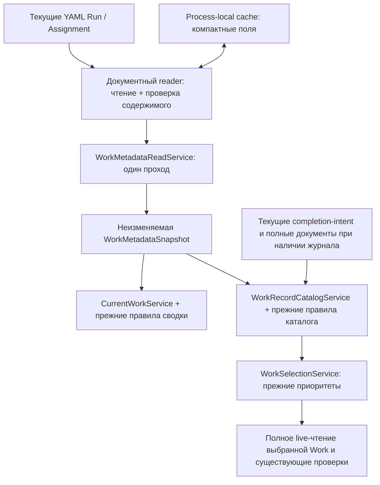

# Общая проекция метаданных Work

Дата: 2026-10-17. Статус: ready_for_review, предложение архитектуры.
Граница результата: проектирование; продуктовый код не изменён.

## Решение о хранении

Проекция живёт в ОЗУ. Источник истины — существующие YAML Run, Assignment и completion-intent. Нового обязательного JSON, SQLite, фонового индексатора или зависимости от Runtime в первом срезе не появляется.

Два срока жизни:

| Уровень | Что хранится | Срок жизни |
| --- | --- | --- |
| Между запросами | Компактные результаты разбора нужных полей, привязанные к текущему содержимому и политике YAML-парсера | Существующий ограниченный process-local YamlParseCache; до вытеснения или завершения процесса |
| Один проход чтения | Неизменяемая упорядоченная WorkMetadataSnapshot, которую разделяют сводка и каталог выбора | Только явная операция чтения, например сборка одного pf.context |

«Общая» означает общую ответственность внутри Core для CLI, MCP и Runtime. У разных процессов своя память. Они читают одни авторитетные файлы и не синхронизируют кэши по сети или через обязательную службу.

Существующий кэш разбора уже умеет держать выбранные поля и проверять хеш текущего содержимого. Его следует использовать через общий документный reader, с одним каноническим набором полей для каждого типа документа. Второй универсальный кэш, второй YAML-парсер и ещё один владелец политики safe loader не нужны. Изначально существующие бюджеты 64 MiB / 4096 entries / 2 MiB на entry не увеличиваются; это оценки удержания графов, а не предел RSS. Фактическую вместимость тонкой проекции проверяет будущая приёмка.

## Почему это соответствует диагнозу

В диагностике два последовательных обхода Work заняли 92.484% одного handler-вызова 17.337 с. Повторный запрос всё ещё дал 2689 разборов и 2689 вытеснений, поскольку история и полные графы заполнили кэши. Это результат существующей реализации, не прогноз новой скорости.

Нужно устранить повторную сборку каталога и удержание всей истории для обнаружения Work. Само чтение текущих файлов сохраняется. В cProfile суммарные read_text занимали 1.039 с при инструментированном wall 43.538 с; это основание сначала убрать стоимость разбора/копирования, а не ослаблять проверку файлов. Вложенные времена не складываются как независимые этапы.

Источник измерений: [диагностика](../pf-context-latency-20261017/report.md), [числа](../pf-context-latency-20261017/public-summary.json). Новых замеров реализации в этой работе нет.

## Владельцы и поток данных

Предлагаемые имена внутренних типов не являются новым публичным API.

WorkMetadataReadService в области work отвечает за инвентаризацию и чтение общих фактов. Он не выбирает Work, не определяет готовность, не выдаёт разрешения и не владеет lifecycle. CurrentWorkService и WorkRecordCatalogService получают один снимок в явной операции чтения и применяют собственные правила. Composition собирает зависимости; MCP передаёт/использует общий Core-проход, не копирует предметные алгоритмы.

Существующие полные методы YamlWorkRecordReader и WorkRecordReadPort сохраняют смысл. Тонкий путь добавляется отдельной явной зависимостью; нельзя подменить load_run/load_assignment усечёнными словарями. Подставляемые readers и существующие конструкторы должны сохранить нынешнее поведение. Развитие конкретной composition не требует Kernel, DI-контейнера или общего Repository[Any].

Точная каноническая пара run_id + assignment_id уже имеет путь без глобального каталога. Он сохраняется: создание общей проекции не должно заставлять каждую точную операцию обходить все Work.

## Состав общих фактов

| Источник | Поля для обнаружения |
| --- | --- |
| Run | Фактический путь; id/status/process/objective/created_at/updated_at; упорядоченные ссылки tasks с id/status; признаки отсутствия, формы документа и ошибки |
| Assignment | Фактический путь; id/run_id/status/stage/process/objective/created_at/updated_at; session.id; признаки отсутствия, формы документа и ошибки |
| Дополнительные входы | Наличие first-assignment; текущее наличие completion-intent для каждого найденного Run; привязка session читается её существующим владельцем |

Снимок сохраняет порядок обхода Run и порядок/повторы task references. Assignment читается один раз на физический источник в пределах прохода, даже если на него ссылаются несколько строк. Не вводится безусловное сканирование всех сиротских assignments: состав входов определяется нынешним WorkInventory, ссылками из Run и специальным first-assignment.

Нельзя преждевременно превратить отсутствующее/null/false/пустую строку в одно значение: существующие fallback и str/or-преобразования различаются. Также нельзя нормализовать некорректные типы в «исправленные» данные. Полный safe YAML по-прежнему проверяется; сохранение error marker, fallback parser и порядка исключений остаётся у текущего reader. Необычные формы/циклы, которые нельзя безопасно представить компактным значением, идут через прежний полный путь без межзапросного удержания.

В межзапросном кэше и снимке обнаружения отсутствуют stage_history, evidence, iterations, тексты артефактов, валидированные capsules и готовый ответ pf.context. Извлечение выбранных полей само по себе не означает потоковый YAML-парсер: при первом чтении или изменении файла существующий парсер пока разбирает весь документ, затем оставляет компактный результат. Не обещать устранения этого холодного расхода.

## Правила сводки и выбора остаются разными

CurrentWorkService сейчас считает строку активной, если активен статус задания ИЛИ Run. Каталог выбора использует активное задание И активный Run, а также действительный незавершённый completion intent. Это разные действующие контракты. Общий снимок предоставляет факты, а не единственный universal active.

Также сохраняются:

- В сводке — строки Run без tasks, fallback при отсутствии Assignment и обработка first-assignment.
- В каталоге — проверки идентификаторов/принадлежности, пропуск отсутствующих или неподходящих записей и include_historical.
- В селекторе — bound session, точные selectors, неоднозначность нескольких assignments одного Run и существующий preferred_record с приоритетами session и updated_at/created_at/assignment_id.
- Ограничение active_work[:10] применяется только к готовой сводке. Оно не сокращает кандидатов селектора и не является основанием выбора Work.

Объединение этих правил было бы отдельным изменением поведения; в этот рефакторинг оно не входит.

## Как поддерживается актуальность

Каждая новая операция чтения выполняет следующий проход:

1. Снова получает текущий список Run через WorkInventory, учитывая добавление, удаление и переименование.
2. Читает текущее содержимое каждого необходимого Run и Assignment. Для выбора результата разбора reader проверяет хеш декодированного текста и действующую политику safe parser, как сейчас; равные size/mtime не доказывают актуальность.
3. Для неизменившегося содержимого получает компактные поля из кэша; новое или изменённое содержимое разбирает и проецирует. Политика парсера и канонический набор полей входят в ключ. Изменение любого из них исключает старое попадание.
4. Проверяет текущее наличие completion-intent, в том числе у терминальных Run. Для найденных журналов выполняет существующее чтение и проверку через CompletionIntentReadService/CompletionIntentValidationService.
5. Собирает новый неизменяемый снимок, который используют оба потребителя текущего прохода. Предыдущий снимок целиком между запросами не переиспользуется.

Чтение и хеширование всех нужных файлов остаются линейными по числу файлов и объёму текста. Повторный YAML-разбор истории при тёплом вместившемся рабочем наборе исключается; новые/изменённые файлы и вытеснения всё ещё могут требовать разбора. Размер/mtime допустимы как диагностические подсказки, но не как обход проверки содержимого. TTL и watcher не нужны для корректности.

| Событие | Как будет замечено |
| --- | --- |
| transition/start/complete/cancel в том же процессе | Следующий проход снова читает текущие файлы; после записи внутри одной внешней операции начинается новый проход |
| Запись CLI или другого MCP/Runtime-процесса | Следующий проход видит новые байты без межпроцессного уведомления |
| Ручная правка, Git checkout, восстановление с прежним size/mtime | Проверка текущего содержимого исключает прежний результат при изменении текста |
| Удаление или повторное создание | Повторная инвентаризация и проверка существования; удалённая запись не воскресает из кэша |
| Появление/удаление completion-intent без изменения Run | Наличие журнала проверяется отдельно; прежнее отсутствие не считается постоянным |
| Невалидный YAML или ошибка чтения | Сохраняется нынешний результат/исключение; последний успешный снимок не подставляется как актуальный |
| Новый процесс или новая загрузка Core | ОЗУ пуста, снимок строится заново; миграция индексных файлов не требуется. Замена файлов Core сама по себе не обновляет уже загруженный код процесса |

Хеш разобранного текста — внутренний ключ оптимизации, не доказательство исторически одобренных bytes и не разрешение. Все raw-byte fingerprints, containment, capsule/source validation, process pins и текущий доступ остаются на прежних проверках.

## Pending completion — отдельная граница

Одного exists или поля pending_completion недостаточно. Нынешняя проверка журнала использует собственный fingerprint, владельца, final Run/Assignment, process/snapshot pins и допустимые пути.

Поэтому базовая метадата хранит только наблюдение о наличии журнала. При его наличии каталог загружает текущие полные Run/Assignment и journal и вызывает прежнего владельца в прежнем порядке для допустимых кандидатов. Успешная валидация intent не кэшируется глобально. Для Run без журнала не требуется разбирать его полную историю ради этой проверки.

При реализации нужно сохранить случаи, когда path-derived run_id пригоден для каталога, а отсутствующий raw run.id исключает intent lookup; не «исправлять» raw id перед вызовом валидатора. Ошибочный журнал не превращается в действительное pending completion. Recovery, replay и удаление журнала принадлежат существующим completion-службам.

## Согласованность и параллельная работа

Снимок относится к одному явному проходу чтения. Оба представления используют одни наблюдённые факты; это устраняет два независимых обхода. Он не обещает атомарный срез всей файловой системы. Текущий PF публикует некоторые файлы атомарно, а Run/Assignment/journal меняются несколькими записями; есть и legacy direct task write. Глобальную транзакцию из кэша вывести нельзя.

После любого write нельзя продолжать читать прежний снимок, даже внутри одного request_scope. Предпочтительно передавать снимок явно только в read-only сборку pf.context/аналогичную операцию. Обычные вызовы readers начинают новый проход. Не вводить неявный ContextVar-кэш Work до конца произвольного handler: он нарушил бы read-after-write без полной карты всех writers. Писатели не обязаны обновлять кэш и отправлять invalidation; источником остаётся повторное чтение.

Выбранная Work затем заново читается полностью через существующий native путь, включая текущие identity и canonical checks, pins, capsule, access и evidence. Snapshot не возвращает сохранённые тела вместо этого чтения. Если при final load изменились сами метаданные, нельзя использовать их как доказательство старой готовности: действуют прежние проверки/ошибки/recovery. Не добавлять бесконечный retry, новую блокировку всего проекта или новый публичный error ради кэша. Более сильная согласованность summary/current при конкурентной внешней записи потребовала бы отдельного контракта и не заявляется этим срезом.

В process-local parse cache блокируется только доступ к entries/counters, а чтение, parsing и копирование остаются вне lock. Неизменяемый снимок не меняется на месте; два потока могут независимо построить снимки. Общие предметные поля не смешиваются с выбором конкретной session. Кэш не заменяет существующие writer locks или scopes.

## Память и пределы решения

Использовать существующий bounded cache с каноническими компактными field sets. Не сохранять исходный текст как request-cache key без уже существующих ограничений и не увеличивать бюджеты для удержания полных историй. Новый снимок содержит только компактные факты; потребителям, которым нужен dict/list, возвращаются независимые представления.

Не вводить новый лимит входных YAML или усечение Work ради ограничения кэша. Большие/неподдерживаемые данные проходят прежний путь без удержания. После операции снимок освобождается. Приёмка должна измерить также временные пики парсера и размер request-снимка: существующий лимит parse cache их не ограничивает.

Разные проекции одного документа не должны плодиться из-за порядка полей или независимо заданных наборов. Старые full-document чтения остаются у реальных потребителей полных документов. На текущем корпусе нужно подтвердить, что тонкий набор удерживается без повторяющегося LRU вытеснения. Если это не выполняется, зафиксировать замер и отдельно обосновать разделение квот в том же cache owner; не скрывать проблему обещанием «кэш теперь быстрый».

Первый вызов нового CLI-процесса холодный. Долгоживущие MCP/Runtime получают преимущество между запросами; одиночный CLI получает общий проход и меньшую стоимость удержания, но не межпроцессную память. Конкретные секунды и MiB пока не измерены.

## Отклонённые варианты

| Вариант | Причина |
| --- | --- |
| Хранить весь pf.context до TTL | Смешивает изменяемые Work, session, доступ и readiness; создаёт устаревшие ответы |
| Верить только size/mtime или watcher | Нарушает существующий контракт current-content и пропускает восстановление/ручные правки |
| Переиспользовать первый active_work | Меняет выбор, неоднозначность, историю и pending completion |
| Сначала убрать все terminal Run | Теряет completion recovery и исторический поиск |
| Просто увеличить RAM-кэш | Не устраняет два обхода и обработку всей истории |
| Новый обязательный SQLite/JSON sidecar | Добавляет cross-process writes, locks, crash recovery и invalidation без измеренного обоснования |
| Фоновая перестройка через Runtime | Усложняет file-first работу и не доказывает актуальность внешних правок |

Постоянный производный индекс можно обсуждать отдельным срезом, если после реализации именно холодный CLI останется неприемлемо медленным. Такой индекс всё равно должен проверять текущие авторитетные файлы при нынешнем контракте, восстанавливаться из YAML и не становиться владельцем прав. Текущая архитектура не требует его заранее.

## Критерии приёмки будущей реализации

1. Полные CLI/MCP payload, порядок, ошибки и результаты выбора совпадают на замороженном корпусе, включая все различия двух представлений.
2. В одном pf.context один metadata inventory pass; нет двух полных сканирований истории и нет полной загрузки каждой завершённой Work ради summary/catalog.
3. На неизменённом текущем корпусе после прогрева число разборов исторических Run/Assignment близко к нулю и объяснимо; отдельно учитывать полное чтение выбранной Work и intent. Не выдавать cache hit за пропуск чтения.
4. Проверены same-size/restored-mtime edit, удаление/повторное создание, разные проекты/сессии/процессы, read-after-write внутри handler, invalid YAML и изменение parser policy.
5. Проверены pending completion на terminal Run, invalid/mismatched intent, отсутствие raw id, несколько tasks, missing assignment, bootstrap, пустые/некорректные формы, task-order/duplicates и неоднозначность selectors.
6. Проверены конкурентные read/write без stale fallback, общая память/вытеснения и независимость mutable возвращаемых значений.
7. Холодные и тёплые wall/CPU, parse counts, число обходов и retained/peak memory измеряются отдельно на одном корпусе; новая фактическая connected-MCP latency подтверждается после отдельно разрешённой установки/переподключения.

Сейчас выполнен обзор архитектуры по текущему коду и сценариям. Эти критерии — план будущих проверок, не результаты тестирования реализации.

## Основания и дальнейшая граница

Архитектура следует [уточнению рефакторинга](../oop-refactor-clarification-20261005/clarification.md), [доменной карте](../pf-core-domain-map-20261005/domain-map.md), [плану выделения существующих обязанностей](../pf-core-domain-map-20261005/refactoring-plan.md), [контракту чтения YAML](../../../docs/concepts/document-reads.md) и [плану уже принятого compact parse reuse](../yaml-read-performance-20261017/architecture.md). Локальные Python practices использованы как вспомогательная база, без нового framework.

Точки кода: work/records.py и work/inventory.py; work/projection.py; work/record_catalog.py; work/selection.py; completion/intent_read.py и intent_validation.py; documents/reader.py и parse_cache.py; common/request_scope.py; composition.py; tools/pf_runtime/mcp_server.py. Полные выбранные данные и проверки остаются у ProcessExecutionService.

[План реализации](implementation-plan.md) и [журнал решений](decision-log.md) описывают следующий отдельный срез. Эта Work завершается архитектурой; реализация, архив, установка и release qualification в неё не входят.
