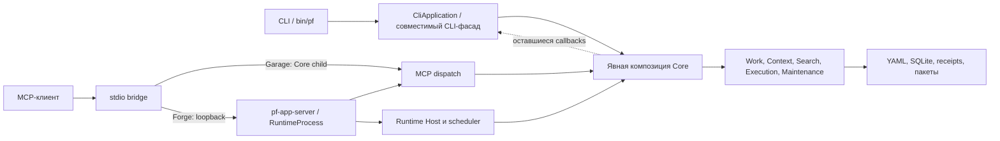

# Карта компонентов ProcessForge 1.x

Срез `336b61d470c2a68b4091e6667921a22ecf135ce5` в `dev`. Карта показывает владельцев и основные пути между ними. [Роадмап](README.md) · [Сверка решений](findings.md) · [Модульный указатель](modules.csv)

## Входы и состав приложения

| Область | Код и роль | Граница и активный остаток |
| --- | --- | --- |
| CLI | `bin/pf.py` запускает `tools/processforge.py`. `CliApplication` выполняет разбор, диагностику и вызов. Семейства команд зарегистрированы в `tools/pf_cli/parsers`. Выделенные адаптеры находятся в `tools/pf_cli/commands`. | `build_parser` всё ещё собирает команды и процедурные handlers. `native_action_result` выдаёт отдельный `NativeResult` через `CommandOutput`; это результат конкретного вызова. [CLI-фасад](../../../tools/processforge.py#L18514) · [Типы ответа](../../../src/processforge_core/operations/result.py) |
| MCP | `mcp_server` публикует schema, annotations и JSON-RPC dispatch. `mcp_bridge.BridgeState` удерживает stdio, сопоставляет каталог и subscriptions. `ActionToolService` и `ActionCatalog` представляют декларации операций. | Garage направляет запрос в дочерний Core. Forge направляет его существующему Runtime. Backend и ошибки имеют собственную границу. Декларация действия не выдаёт доступ. [Bridge](../../../tools/pf_runtime/mcp_bridge.py#L218) · [Dispatcher](../../../tools/pf_runtime/mcp_server.py#L1387) |
| Сервер | `bin/pf-server.py` передаёт alias `server` штатному CLI. `RuntimeProcess` владеет временем жизни, singleton, loopback HTTP и scheduler. `host` маршрутизирует проект, сессии, ingress, Work и derived projections. | `host.work_state_payload` собирает текущее Work, obligations и состояние запуска через живые источники. В некоторых host operations используется широкий `core`. [RuntimeProcess](../../../tools/pf_runtime/service.py#L556) · [Пример агрегирования](../../../tools/pf_runtime/host.py#L2540) |
| Bootstrap | `RuntimeBootstrap`, `CoreProperties`, `build_runtime_bootstrap` и `composition.build_*` связывают выбранный дистрибутив с прикладными владельцами. | `bootstrap._load_legacy_core` загружает совместимый CLI-модуль. Build, schema и protocol имеют различные идентичности. Составы проверяются без I/O при конструировании, кроме явно запрошенных операций. [Bootstrap](../../../src/processforge_core/bootstrap.py#L126) · [Core Properties](../../concepts/core-properties.md) |

## Прикладные владельцы

Пути в таблице относятся к `src/processforge_core`, если указан только пакет.

| Подсистема | Основные классы, функции и интерфейсы | Состояние и направления вызова |
| --- | --- | --- |
| Work и lifecycle | `ProcessExecutionService`, `WorkSelectionService`, `CurrentWorkService`, `WorkStatePolicy`, `YamlWorkRecordReader`, `WorkRecordReadPort` и `WorkContextReadPort`. | Выбор точной пары, stage/outcome и scope; YAML и capsule reader; запирание и отказ на неполных данных. Coordinator всё ещё получает `core` для части path, lock, project status и process resolution. [Coordinator](../../../src/processforge_core/process_execution.py#L278) · [Reader](../../../src/processforge_core/work/records.py) |
| Публикация, продолжение и завершение Work | `WorkStartPublicationService`, `WorkTransitionCommitService`, `ContinuationService`, `ContinuationPublicationService`, `CancellationReplayService`, `CompletionIntentBuilder`, `CompletionIntentReplayService`, `WorkCompletionRequestService`. | Intent/receipt, повтор, запись документов, событий и представлений. `ProcessExecutionService` сохраняет admission и lock. Совместимые SQL/compact проекции и объекты принадлежат `SqlWorkRepository` и `ProjectObjectStore` при применимых настройках. [Публикация](../../../src/processforge_core/work/start_publication.py#L43) · [Commit](../../../src/processforge_core/work/transition_commit.py#L13) · [Completion](../../../src/processforge_core/completion/request.py) |
| План, evidence и представление | `EvidenceCollectionPolicy`, `EvidenceValidationService`, `StageReadinessPolicy`, `AutomationReadinessService`, `WorkSummaryRenderer`. `AuthoringInputService`, `AuthoringJournalStore`, `KnowledgeCandidateTargetingPolicy` и `EvolvePrivacyPolicy`. | Текущие обязательства, Gate и outcome, формат отчётов и выделение знания. Определение процесса задаёт переход, политика раскладывает факты. Поздние callbacks и text writers ещё отделяются по конкретным потребителям. [Evidence](../../../src/processforge_core/evidence) · [Authoring](../../../src/processforge_core/authoring) · [Evolution](../../../src/processforge_core/evolution) |
| Контекст, project lifecycle и настройки | `ProjectContextService`, `ProjectContextPolicy`, `ProjectSnapshotReadService`, `ProjectSnapshotSourcesReader`, `ContextReconciliationService`, `ProjectConfigurationReader`. `ConfigService` использует `ConfigStore` и `YamlConfigStore`. | Project snapshot, policy locks и effective config, декларации проектных платформ/типов, discovery/init и живые чтения. D18 применяется к выбранной операции и worker. Часть цепочки снимок → checker → consumer ещё завязана на legacy. [Контекст](../../../src/processforge_core/project/context.py) · [Config](../../../src/processforge_core/configuration/service.py) |
| Каталоги и регистрация | `ProcessDefinitionReadService`, `ProcessSelectionService`, `ProcessPinReadService`, `OfficialProcessPackReader`, `ProcessSemanticPolicy`, `TemplateCatalogService`, `WorkplaceRegistryReader`, `WorkplaceRegistryWriter` и `ProjectPackageCatalogReader`. | Читают active declarations, предлагаемые процессы и version pins. Пользовательские процессы и overrides сохраняются. Каталог описывает права и доступность, сквозной допуск выполняет текущий владелец операции. [Process catalog](../../../src/processforge_core/process_catalog) · [Registry reader](../../../src/processforge_core/resources/registries.py) |
| Ресурсы и поиск | `ResourceIdentityPolicy`, `WorkplaceSearchCatalogReader`, `ResourceSearchService`, `ResourceResolveService`, `ResourceIndexBackend`, `WorkplaceIndexMaintenanceService`, `WorkResourceService`, `WorkMaterialReadService`. `local_search.search_material` работает на verified Work documents. | Один физический derived FTS на Workplace, разрешённый экземпляр/корень из снимка для `pf.search`. Work использует pinned material и current access. `LegacyResourceSearchReadAdapter` подаёт прежний context checker. Writer запускается через явное обслуживание. [Reader ports](../../../src/processforge_core/resources/access.py) · [Maintenance](../../../src/processforge_core/resources/index_maintenance.py) · [Work material](../../../src/processforge_core/work/material_read.py) |
| Подготовка, драйверы и попытка | `WorkAssignmentService`, `PreparedResourceSnapshotReader`, `PreparedKnowledgeResourceReader`, `PreparedRegistryResourceReader`, `WorkerPlanPolicy`, `RuntimeDriverSelectionService`, `WorkerEnvironmentPolicy`, `CapturedAttemptReader`, `CollectionRecoveryStore`. | Prepared input хранит pins и разрешения, отдельно declarations MCP. Reserve / launch / collect связывают attempt, output и receipt. CLI/host сохраняют реальный admission, generic shell и native имеют разные ownership proofs. [Prepared](../../../src/processforge_core/prepared) · [Drivers](../../../src/processforge_core/runtime) · [Owned control](../../../tools/pf_native_control.py) |
| SQL и миграции | `DatabaseFactory`, `DatabaseDriver`, `SqlSession`, `SQLiteDriver`, `SchemaManager`, `ExecutionService`, `ExecutionRepository`, `SQLiteExecutionRepository`, `StorageMigrationService` и `JournalMaintenanceService`. | Целевые Store UUID, версия схемы, admission, владельцы транзакций и checkpoints. Текущая активность и история обслуживаются раздельно. Исторические журналы пересекают границу только в явной миграции и recovery. [Database](../../../src/processforge_core/database) · [Execution SQL](../../../src/processforge_core/executions) · [Migration](../../../src/processforge_core/maintenance/storage_migration.py) |
| Журналы, hooks и сессии | `ProcessEventJournal`, `RawHookJournal`, `RuntimeHookDispatcher`, `HookDispatchPolicy`, `AgentPresenceReader`, `SessionMetadataWriter`, `ChatTranscriptReader`/`ChatTranscriptWriter`, `RuntimeServiceStateStore`. | Журнал держит admission/pending/verification, диспатчер публикует target и receipt. Host удерживает текущие маршруты и передаёт нормализованные факты. Часть состояния Ledger и maintenance живёт в совместимых процедурах. [Hook dispatch](../../../src/processforge_core/agents/hook_dispatch.py#L19) · [State store](../../../src/processforge_core/runtime_service_state.py) |
| Обновления и релизы | `UpdateCandidateReader`, `UpdateVersionSelectionPolicy`, `UpdateTransferService`, `ReleaseManifestPolicy`, `PublicSourcePolicy`. `maintenance.file_update.apply_file_update`, `maintenance.update.workplace_migration_plan` и `apply_workplace_migration`. | Discovery, пакетный stage/apply/rollback и файловая публикация Core различаются. CLI ещё ведёт большую часть package update apply. Before-manifest restart/rollback и `--manage-runtime` используют свои guards. [Кандидаты](../../../src/processforge_core/maintenance/candidate_read.py) · [Пакетный apply](../../../tools/processforge.py#L16134) · [Core update](../../../src/processforge_core/maintenance/file_update.py) |
| Agent entry, managed egress, usage | `agent_entry.Contract` и функции plan/apply/diagnose, `egress.engine.Session`, `egress.storage.Store`, `JsonTransport`, `AccountingService`, `SQLiteAccountingRepository`. | Глобальная bounded section ещё формируется в CLI. Agent entry и host loading имеют разные proofs. Managed egress имеет собственные ограниченные полномочия. Usage хранится отдельно и keyed by project. [Agent entry](../../../src/processforge_core/agent_entry) · [Egress](../../../src/processforge_core/egress) · [Accounting](../../../src/processforge_core/accounting) |

## Общие функции и узкие интерфейсы

- `common` владеет часами, идентификаторами, чтением JSON/YAML/NDJSON, digest и общими проверками записей. `documents.YamlDocumentReader` и `FileDigestReader` нужны прикладным сервисам как конкретные читатели. Чистые нормализаторы и преобразования остаются функциями. [Общие функции](../../../src/processforge_core/common) · [Чтение документов](../../../src/processforge_core/documents)
- `ports.py` хранит небольшие Work/process/snapshot reader-границы. Другие Protocol находятся возле владельцев `ConfigStore`, `ExecutionRepository`, `ResourceIndexBackend`, `DatabaseDriver`, prepared readers и completion consumers. Протокол описывает вызов Python. Доступ к файлам подтверждает текущая политика. [Core ports](../../../src/processforge_core/ports.py) · [SQL contract](../../../src/processforge_core/database/contracts.py)
- Windows Task Scheduler, native Windows ownership, Linux namespaces/pidfd и hosted MCP clients — адаптеры среды. Их результаты принадлежат исходной поддерживаемой команде и попытке. Проверки фикстур и реальные подключённые клиенты имеют разные доказательства. [Runtime adapters](../../../tools/pf_runtime) · [Linux ownership](../../concepts/linux-owned-execution.md)

## Как читать инвентарь

426 Python-модулей, включая 339 Core, 45 CLI, 25 Runtime adapters, два launcher и 15 операторских/maintenance/QA модулей. Учитываются 605 объявлений классов, включая 56 Protocol и 231 dataclass, 1 870 функций уровня модуля, 1 873 метода и 155 вложенных функций. Разметка получена статическим AST с именами и строками; imports показывают объявленные связи, а динамические callbacks проверены в выбранных реальных цепочках. Inventories не являются измерением line/branch coverage или процента завершения. Строка 575 монолита оказалась длиннее лимита IDE; AST использовал нейтральное содержимое одного проверенного литерала. Нативная команда воспроизвела его фактический вывод отдельно. [Метод и выводы](findings.md)
