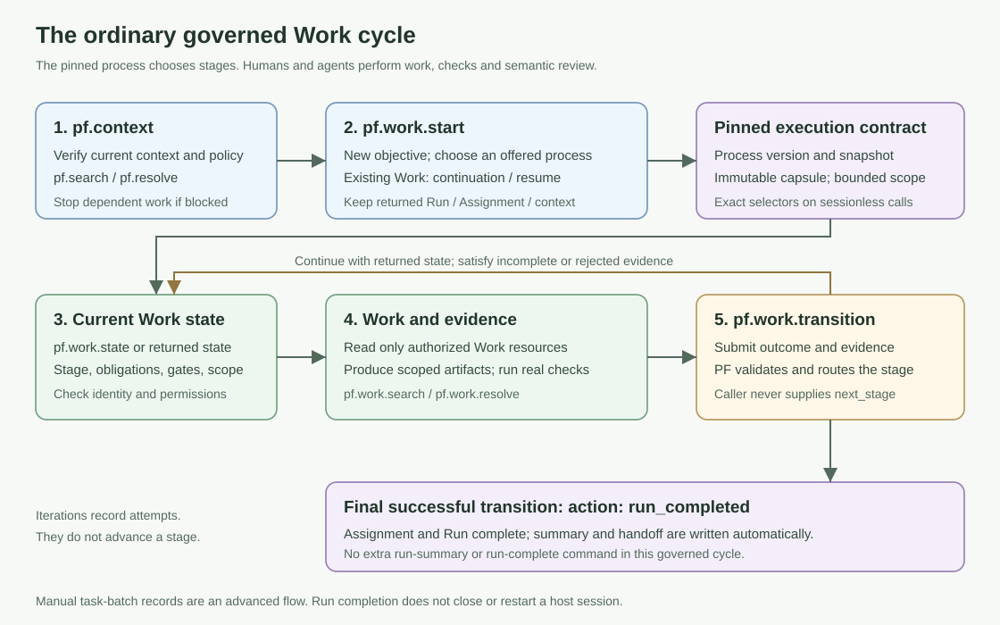

# Runtime Model



ProcessForge uses short-lived CLI commands by default. A command reads project
and workplace files, writes the requested artifact or runtime record, and
exits. The optional Runtime host and MCP facade are adapters around the shared
Python Core; `tools/processforge.py` remains the legacy CLI-adapter boundary.

The file layout is the runtime contract:

- `.pf/process-forge.yaml` stores the project manifest.
- `.pf/contexts/` stores refreshed context snapshots.
- `.pf/runs/` stores run records.
- `.pf/assignments/` stores task and iteration records.
- `.pf/artifacts/`, `.pf/reviews/`, and `.pf/handoffs/` store evidence and
  delivery material.
- `.pf/runtime/events/events.sqlite3` stores optional event envelopes and required admission/verification state.
- `.pf/runtime/agent-events/hooks.sqlite3` stores project hook receipts, pending input and optional raw history.
- `.pf/runtime/agent-runs/` stores optional worker process state.
- `.pf/runtime/supervisor/` stores optional supervisor loop state.

## Project raw ingress

After validating the project route, agent-native payloads are first committed
to its private Raw Hook Journal under `.pf/runtime/agent-events/`. SQLite
stores receipts, optional payloads, quarantine and pending recovery input;
replay checkpoints remain under this project directory. Agent Ledger and
Runtime service state/logs remain workplace-scoped.

Ingress performs indexed admission and current effects. It does not rebuild
command history or stage projections. History export/rebuild is explicit;
periodic stage projections refresh after file inputs or latest verification
facts change. Unchanged ticks inspect metadata without reparsing assignments
or hashing outputs. Work gates still verify current authoritative inputs.
See [SQLite journals and migration](hook-journal-sqlite.md) and
[logging configuration](../authoring/workplace-configuration.md#project-history-and-raw-hooks).

The release archive includes `src/processforge_core`, `tools/processforge.py`
and `tools/pf_runtime/*` source, but never workplace raw journals, chat
transcripts, quarantine data, event indexes or replay checkpoints.

The core CLI runtime does not require a daemon. Optional Runtime Host helpers
can run as short-lived file-first ticks, and the optional PF Runtime service can
run as a long-lived workplace process when explicitly started or installed for
Windows autostart.

Runtime drivers and the process supervisor are optional runtime helpers. See
[Runtime drivers](runtime-drivers.md) and
[Process supervisor](process-supervisor.md).

## Distribution Root Versus Linked Project

From the distribution root, run:

```bash
python bin/pf.py release-test --root .
```

Inside a linked project, run:

```bash
python .pf/runtime/bin/pf.py doctor-project --project-root .
```

## Runtime Requirements

Runtime usage expects Python 3.11+ recommended, Python 3.10+ only when the current tests confirm compatibility, Python package dependencies from `requirements.txt` including `PyYAML`, a UTF-8 capable filesystem, and read/write access to the ProcessForge distribution, workplace, and project folders.

Default Runtime usage does not require PowerShell, Git, a daemon, or a
background process. Git is only needed when the user wants version-control
integration or when development/release checks are being run. Optional PF
Runtime service startup is documented in
[Runtime Autostart And Codex MCP Startup](../getting-started/runtime-autostart.md).

## Runtime, Ledger, and MCP interfaces

PF Runtime is a workplace-scoped local lifecycle host, scheduler, and IPC
transport. It is not a second PF Core. Agent Ledger owns agent/session
presence and the canonical session-to-project binding; Runtime's project and
session maps are rebuildable caches only.

Runtime status reports scheduler liveness as `scheduler_alive`. A failed scheduler
operation or malformed routing cache degrades health while other valid projects continue;
a successful later pass restores health. A stopped scheduler is never reported
as healthy merely because the IPC lifecycle status is still `ready`.
Worker failures and collection recovery requirements remain task results, visible
in each project's `inspector_result` under `last_scheduler_result`; they do not
degrade a successfully operating service. `supervisor tick` and Runtime-host
tick retain their nonzero exit/task status for failed outcomes. Runtime-host
tick additionally reports `scheduler_status` for operational health, without
repeating inspection or accepting a blocked collection. A successfully published
metrics sample is a successful job even with partial coverage; its unknown counts,
lower bounds and coverage issues remain explicit.

Runtime state and Host history publication use unique atomic staging files.
Failed write/replacement removes only that invocation's staging and preserves
the original error and destination. Windows sharing-conflict retry stays bounded
to the existing50ms admission window. Hook installation retains its configuration
backup while cleaning failed staging. No orphan scan runs on incoming hooks.
Forced process termination and filesystem cleanup denial can still leave files;
stale-file maintenance requires exact paths and verified inactive owners.
Singleton acquisition preserves live or unverifiable owners even when their
lock is missing or inconsistent. Dead ownership records can be recovered; a
live PID alone is insufficient evidence that an incomplete record is stale.

A routed session is recovered from the Ledger record's `project_id` and
`project_root`. A request or event that names a different project is rejected.
This keeps recovery after Runtime-cache removal and cross-project isolation
independent of the daemon.

Codex hooks are thin fact adapters. They normalize documented lifecycle or tool
facts, append existing PF events, and delegate check-in, heartbeat, and
checkout to Core. The stdio MCP facade is mostly bounded/read-oriented, but it
also exposes governed mutation tools for project initialization, repair, and
work bootstrap. Those mutating tools are explicit, limited, and require their
documented guard inputs such as `apply: true`.

The stdio MCP process is owned by the MCP host, not by PF Runtime autostart.
Codex starts it from host MCP configuration for each connected session. See
[PF Runtime MCP facade](runtime-mcp.md) and
[Runtime Autostart And Codex MCP Startup](../getting-started/runtime-autostart.md).

## Declaration-driven technical projections

Process definitions may declare a stage `technical_obligations` entry. The
Runtime Host reads that declaration and writes only a separate generated file
under `.pf/artifacts/projections/`; it does not contain stage business rules or
edit semantic reports, handoffs, or output bodies.

The first projector, `required-output-readiness`, is bound to the
`process-supervisor` `collect` stage. It derives the current stage obligation
from the assignment, Inspector worker state, and required-output fingerprints.
Its view is `current`, `stale`, `missing`, or `invalid`. It can be rebuilt with
`runtime-host rebuild-projections` and verified without a daemon using
`runtime-host projection-doctor`.
