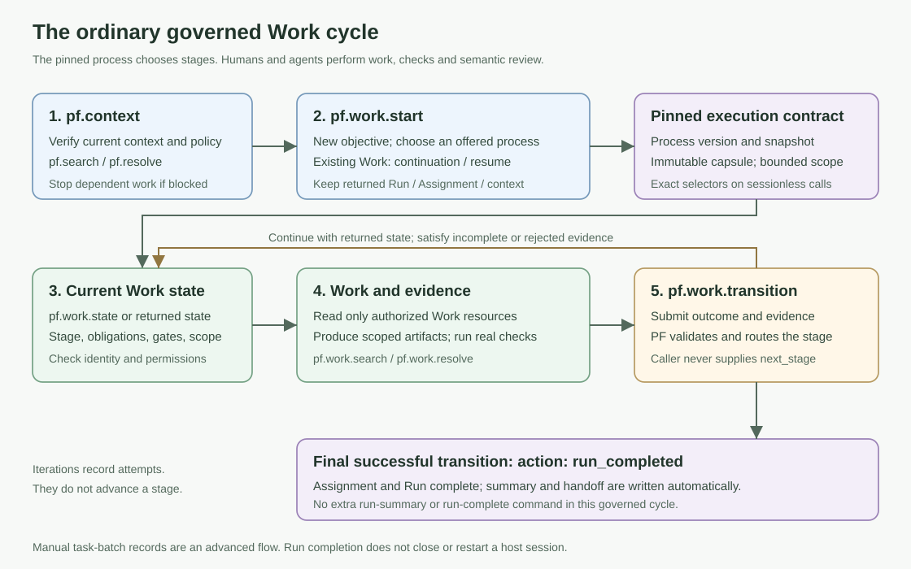

# Модель среды выполнения



По умолчанию ProcessForge использует короткоживущие CLI-команды. Команда читает
project и workplace files, пишет нужный artifact или runtime record и
завершается. Optional Runtime host и MCP facade являются адаптерами вокруг
общего Python Core; `tools/processforge.py` остается legacy CLI-adapter
boundary.

## Как выбрать интерфейс

Для контекста и управляемой Work используйте [Garage](garage-core.md) через
существующий CLI или подключённый MCP. Файловая работа доступна без работающей
службы. Необязательный **pf-app-server** нужен для планирования workplace,
наблюдения за исполнителями и оперативного состояния. Это долгоживущий процесс
PF Runtime, доступный через существующие команды runtime/server.

Приложение управляет stdio-соединением MCP. В Garage новый запрос к ядру
запускает дочерний процесс. При включённом `coordination.director_enabled`
рабочего места мост обращается к запущенному Runtime. После совместимого
обновления следующий запрос через то же соединение может попасть в новый
дочерний процесс или перезапущенный Runtime. [Маршрутизация и обновления MCP](mcp-updates.md)

## Долговечные файлы проекта

File layout является runtime contract:

- `.pf/process-forge.yaml` хранит project manifest.
- `.pf/contexts/` хранит refreshed context snapshots.
- `.pf/runs/` хранит run records.
- `.pf/assignments/` хранит task и iteration records.
- `.pf/artifacts/`, `.pf/reviews/` и `.pf/handoffs/` хранят evidence и delivery material.
- `.pf/runtime/events/events.sqlite3` хранит необязательную историю и необходимые ID и факты проверки.
- `.pf/runtime/agent-events/hooks.sqlite3` хранит квитанции хуков, незавершённую обработку и необязательные сырые данные.
- `.pf/data/pf.sqlite3` — стандартная привязанная база попыток запуска и текущего состояния исполнителей.
- `.pf/runtime/agent-runs/` хранит квитанции, выход исполнителей и проекции для совместимости. [Хранилище исполнений](execution-storage.md)
- `.pf/runtime/supervisor/` хранит optional supervisor loop state.

## Приём хуков проекта

После проверки проекта исходные данные хука фиксируются в его приватном
журнале `.pf/runtime/agent-events/hooks.sqlite3`. История нормализованных событий
хранится отдельно в `events.sqlite3`. Agent Ledger и служебное состояние Runtime
остаются общими для рабочей среды.

Обработчик хука больше не пересобирает историю команд и представления стадий.
История пересобирается явной командой; представление стадий обновляется при
изменении входных файлов или последних фактов проверки. При неизменных данных
очередной такт не разбирает YAML задач и не вычисляет заново хеши результатов.
Проверки Work продолжают проверять актуальные исходные данные. Порядок переноса
описан в [SQLite и миграции журналов](hook-journal-sqlite.md).

Release archive включает `src/processforge_core`, `tools/processforge.py` и
`tools/pf_runtime/*`, но не включает workplace raw journals, chat transcripts,
quarantine data, event indexes или replay checkpoints.

Core CLI runtime не требует daemon. Optional Runtime Host helpers могут
запускаться как короткие file-first ticks, а optional PF Runtime service может
работать как long-lived workplace process, если его явно запустили или
установили Windows autostart.

Runtime drivers и process supervisor являются optional runtime helpers. См.
[Runtime drivers](runtime-drivers.md) и [Process supervisor](process-supervisor.md).

## Distribution Root Versus Linked Project

Из корня дистрибутива:

```bash
python bin/pf.py release-test --root .
```

Внутри подключенного проекта:

```bash
python .pf/runtime/bin/pf.py doctor-project --project-root .
```

## Runtime Requirements

Версии Python, зависимости, требования к SQLite/локальному хранилищу и
планирование ресурсов app-server описаны в общих [требованиях](../requirements.md).
Для изменений нужен доступ к записи в соответствующие workplace и проект;
операции чтения сохраняют объявленные границы доступа.

Default Runtime usage не требует PowerShell, Git, daemon или background process.
Git нужен только для version-control integration или development/release checks.
Запуск службы описан в [руководстве по автозапуску Runtime и подключению MCP-клиента](../getting-started/runtime-autostart.md).

## Runtime, Ledger и MCP interfaces

PF Runtime — workplace-scoped local lifecycle host, scheduler и IPC transport.
Это не второй PF Core. Agent Ledger владеет canonical session-to-project
binding; project и session maps Runtime являются только rebuildable caches.

У каждого нативного вызова MCP свой результат с кодом возврата, данными
операции и диагностикой. Каталог драйверов и статус исполнителя передают
данные в MCP напрямую. CLI пишет своё представление в поток текущего вызова.
Director, Inspector и Ledger передают вывод явно и сохраняют потоки
процесса Runtime.

## Справка по реализации: исправность и восстановление

Далее приведены подробности для диагностики и сопровождения. Они не добавляют
шагов к обычному циклу Work.

Core `RuntimeSchedule` задаёт фактические периоды: Ledger и Inspector — 5 секунд,
Director — 10 секунд, проекции — 30 секунд. Цикл хоста проверяет, какие задачи
пора выполнять. Для каждого проекта время отсчитывается от завершения попытки,
включая неуспешную: медленные операции не вызывают догоняющих циклов. Ошибка
сохраняется до повторной проверки соответствующей задачи. Ручной tick работает
как прежде.

Публичный метод Core `RunTaskInputReader.active_tasks` отвечает за чтение
активных назначений. Он проверяет текущие байты YAML, сохраняет небольшие
заголовки завершённых назначений и читает полные активные документы с повторной
проверкой статуса. Кэш YAML хранит общую политику загрузчика один раз; лимиты
памяти и защита от изменения данных вызывающим кодом сохраняются. Агент
использует публичные операции Work, не управляя этими кэшами.

Поле `scheduler_alive` показывает, работает ли поток планировщика. Ошибка
операции планировщика или повреждение кеша маршрутизации переводит состояние здоровья в
`degraded`; остальные доступные проекты продолжают обрабатываться. После
успешной проверки состояние восстанавливается. Остановка планировщика видна
даже при сохранении состояния IPC `ready`.
Неуспешные попытки исполнителей и требования восстановления сбора остаются
результатами задач. Они видны в `inspector_result` каждого проекта внутри
`last_scheduler_result` и не переводят исправную службу в `degraded`.
Команды `supervisor tick` и Runtime-host tick сохраняют ненулевой код возврата
и статус неуспеха при таких результатах. Runtime-host tick дополнительно
возвращает `scheduler_status` для оценки исправности службы. Повторного обхода
данных или принятия заблокированного результата при этом нет. Успешная публикация
метрик считается выполненной операцией и при частичном покрытии: неизвестные
значения, нижние границы счётчиков и причины неполноты остаются явно указаны.

Состояние Runtime и проекции Host записываются через уникальные временные файлы.
При ошибке записи или замены удаляется только временный файл данной операции;
исходная ошибка и целевой файл сохраняются. Повтор замены при конфликте доступа
Windows ограничен прежним окном 50 мс. Установщик хуков сохраняет резервную копию
конфигурации и удаляет временный файл при неудаче. Входящие хуки не обходят каталог
в поисках остатков. Принудительное завершение процесса и запрет удаления файлов
всё ещё могут оставить временные данные: их очистка требует точных путей и
проверки неактивного владельца.
Захват блокировки запрещён, если её владелец жив или его состояние нельзя
надёжно проверить, в том числе при отсутствии или повреждении lock-файла.
Запись завершившегося процесса допускает восстановление; наличие живого PID
само по себе не доказывает, что неполная запись устарела.

Routed session восстанавливается из Ledger record `project_id` и `project_root`.
Request или event с другим project отклоняется. Это сохраняет recovery после
удаления Runtime cache и cross-project isolation независимо от daemon.

Адаптеры хуков нормализуют полученные от клиента события сессии и инструментов.
Они добавляют события PF и передают Core операции регистрации, подтверждения
активности и завершения сессии. Через MCP также доступны создание Work, чтение состояния,
переход, отмена и продолжение, подготовка, запуск и сбор результата исполнителя,
инициализация и восстановление проекта. У каждого действия свои идентификаторы,
права и требования к `apply`. [Каталог действий](action-discovery.md)

Для каждого соединения MCP-клиент запускает stdio-сервер из своей конфигурации.
[Фасад PF Runtime MCP](runtime-mcp.md) · [Автозапуск Runtime и подключение MCP-клиента](../getting-started/runtime-autostart.md)

## Декларативные технические проекции

Process definition может объявить у stage `technical_obligations`. Runtime Host
читает эту декларацию и пишет только отдельный generated file в
`.pf/artifacts/projections/`; он не содержит stage business rules и не
редактирует semantic reports, handoffs или output bodies.

Первый projector, `required-output-readiness`, привязан к stage `collect`
процесса `process-supervisor`. Он выводит текущую stage obligation из
assignment, Inspector worker state и required-output fingerprints. View может
быть `current`, `stale`, `missing` или `invalid`. Его можно пересобрать через
`runtime-host rebuild-projections` и проверить без daemon через
`runtime-host projection-doctor`.

Native image сохраняется на время процесса, а installation lease удерживается
только во время startup, запроса, scheduler/metrics cycle и finalization. Idle
listener и ожидание следующего cycle не удерживают lease. При смене epoch старый
Runtime отказывает через существующие busy/stale поверхности и не пишет даже
диагностику или final save. Worker, native maintenance script и hook удерживают
lease до завершения собственных side effects; guard использует прежний общий
deadline 500 ms без migration, history scan и capability probe внутри него.
